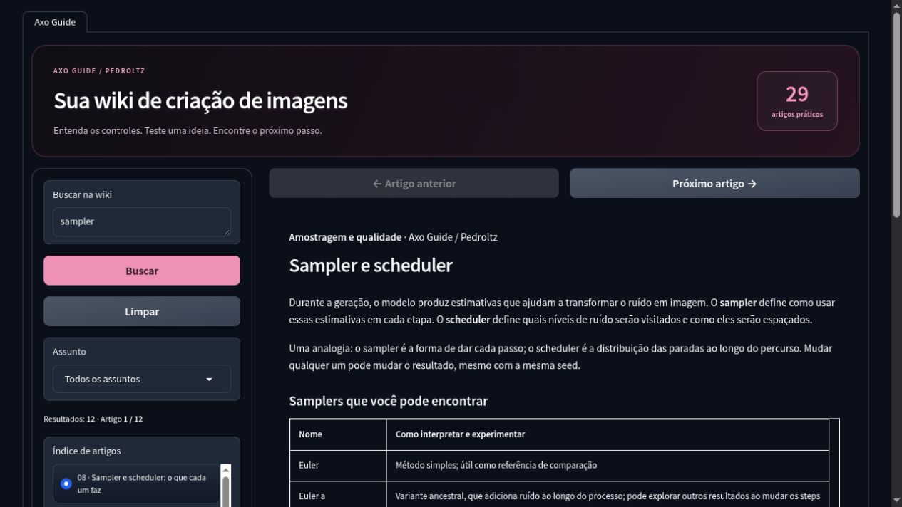
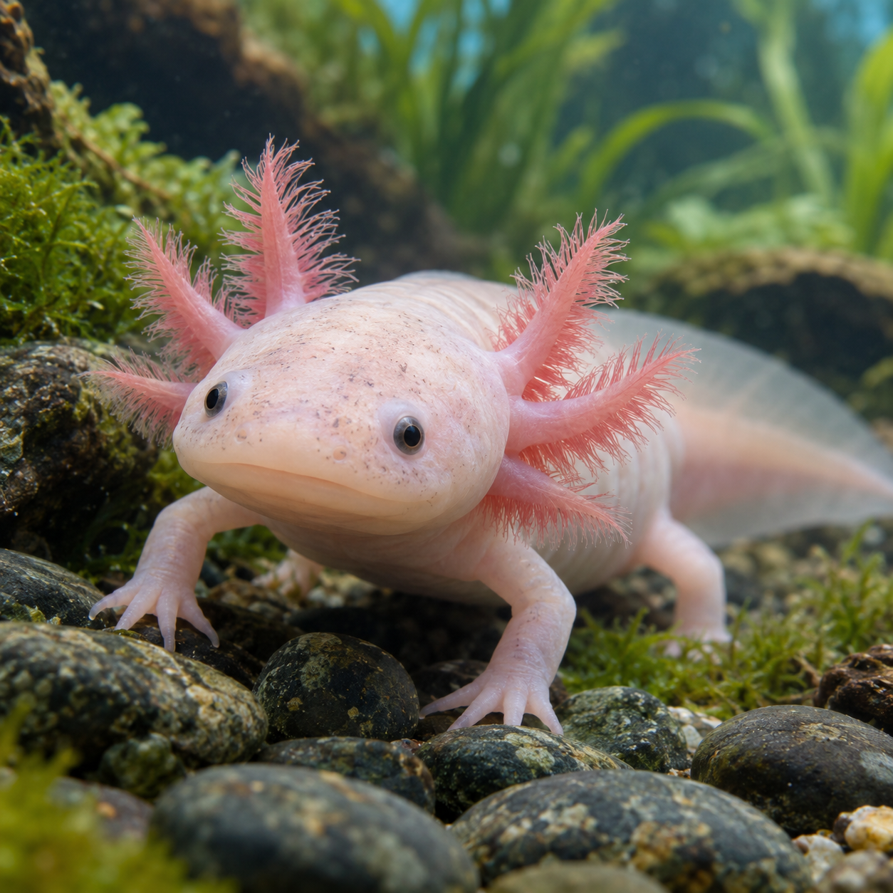

# Axo Image Studio

**Crie, explore e entenda suas imagens.** Um estúdio para Google Colab com galeria própria e uma wiki integrada em português, personalizado por **Pedroltz** sobre o Forge Neo.

[](https://colab.research.google.com/github/Pedroltz/AxoImageStudio/blob/main/Axo_Image_Studio.ipynb#scrollTo=axo-install-launch)
[](https://github.com/Pedroltz/AxoImageStudio/actions/workflows/validate.yml)



*Captura do Axo Guide em uma prévia local da interface, com os módulos de inferência simulados.*

[Começar no Colab](#começar-no-colab) · [Wiki completa](docs/AXO_GUIDE.md) · [Artes e prompts](docs/DEMOS.md) · [Arquitetura](docs/ARCHITECTURE.md) · [Apresentação no LinkedIn](docs/LINKEDIN_POST.md)

## O projeto

Gerar imagens envolve muitos controles: modelos, prompts, samplers, steps, CFG e extensões. O Axo Image Studio reúne um ambiente de criação, uma biblioteca para explorar os resultados e um guia que explica esses controles durante o uso.

O projeto também resolve um problema encontrado na galeria no Colab: miniaturas e prévias passavam pela pasta temporária global do Forge e podiam falhar no carregamento. A galeria própria usa arquivos em um cache local separado e prepara o download original somente quando solicitado.

### A contribuição do Axo

O Forge oferece o motor de geração e suas ferramentas de edição. O Axo adiciona a biblioteca de imagens, o guia em português, a identidade visual e a preparação do ambiente no Colab. O código da galeria e da wiki fica disponível separadamente, além de incorporado ao notebook.

## O que você encontra

| Área | Recursos |
|---|---|
| **Criação** | txt2img, img2img e Inpaint do Forge; configuração para SDXL e Anima |
| **Axo Studio** | Biblioteca com filtros, busca por nome, 24 imagens por página e atualização ao entrar na aba |
| **Prévia e download** | Prévia reduzida, leitura dos parâmetros, download do arquivo original e exportação da página em ZIP |
| **Axo Guide** | 29 artigos em português, busca no conteúdo, categorias e navegação anterior/próxima |
| **Complementos** | Instalação/configuração de ControlNet, ADetailer Neo e CivBrowser |
| **Colab** | Ambiente Python 3.12 isolado, revisões fixadas e opção de persistência no Google Drive |

A wiki explica cada aba e os conceitos de prompts, pesos, prompt negativo, samplers, schedulers, steps, CFG, seed, resolução, Hires fix, LoRAs e Inpaint. Inclui exemplos e referências às fontes originais.

## Artes de apresentação

| Mascote 3D | Fantasia ilustrada | Estilo fotográfico |
|---|---|---|
|  |  |  |

Essas artes foram geradas com uma ferramenta externa para a apresentação do projeto. Os [arquivos e prompts completos](docs/DEMOS.md) estão disponíveis para explorar as ideias no Axo; os resultados dependem do modelo e dos parâmetros.

## Começar no Colab

### Escolher a interface

Na célula **Install and launch**, o dropdown `INTERFACE` permite escolher **Forge Neo** (padrão) ou **ComfyUI**. O seletor `START_WITH` oferece **SDXL** e **Anima** nas duas opções. Execute apenas uma interface por vez; para trocar, interrompa a célula, altere o dropdown e execute a instalação novamente. **Restart** reutiliza a interface instalada.

No ComfyUI, abra o link `trycloudflare.com` exibido no fim da inicialização. Os workflows **Axo Anima** e **Axo SDXL** ficam no menu Workflows; o starter selecionado abre em um navegador novo quando o editor está vazio. Se já houver um grafo aberto, escolha o workflow no menu. Edite o prompt e clique em **Run**. Não há geração automática ao abrir.

O ComfyUI usa um ambiente Python separado e reaproveita os pesos existentes. Downloads desativados continuam desativados: o notebook informa os arquivos ausentes. As imagens são salvas em `outputs/ComfyUI` e os workflows em `comfy-user`, dentro da pasta de armazenamento atual; ambos persistem com Google Drive habilitado. Os starters existentes não são sobrescritos.

**Civitai dentro do ComfyUI:** o notebook instala o [Civicomfy](https://github.com/MoonGoblinDev/Civicomfy). Abra o botão **Civicomfy** no menu superior para pesquisar modelos ou informar o link de um modelo, escolher a versão e baixar. Se precisar de autenticação, crie o segredo `CIVITAI_TOKEN` no Colab e permita seu uso pelo notebook; ele é passado ao servidor sem ser gravado no notebook.

**Modelos do Drive:** ative `USE_GOOGLE_DRIVE = True` para reutilizar `MyDrive/Axo-Image-Studio-Forge/models`, a mesma pasta do Forge Neo. Checkpoints em `Stable-diffusion` (incluindo subpastas), Anima em `Stable-diffusion/Anima`, LoRAs em `Lora`, VAEs em `VAE` e encoders em `text_encoder` ficam acessíveis. Também são reconhecidas pastas como `checkpoints`, `diffusion_models`, `loras` e `text_encoders` dentro dessa raiz. Arquivos guardados em outras pastas do Drive precisam ser adicionados a essa estrutura.

Os downloads do Civicomfy usam essas pastas por padrão; deixe **Global Download Root** vazio para manter esse comportamento. Para modelos Anima, escolha o tipo/destino **diffusion_models** e use **Load Diffusion Model** no workflow. Checkpoints SDXL usam **checkpoints** e **Load Checkpoint**. LoRAs precisam corresponder à família do modelo. Para aplicar esta atualização a uma sessão existente, reabra o notebook da `main` e execute **Install and launch** novamente; apenas **Restart** não instala a extensão.

**Workspace neutro:** mantenha `ENABLE_CHARACTER_WORKFLOW = True` (padrão) na opção ComfyUI. O instalador prepara os nós e pesos e adiciona **Axo Anima Workspace Neutro v4** ao menu Workflows. Todos os prompts começam vazios, os três slots de LoRA ficam em `Nenhuma` e a referência vem desligada, sem imagem selecionada. Preencha o prompt principal com o que quiser gerar. Para usar referência, envie/selecione uma imagem no nó 05 e ligue `use_reference`. Os prompts locais de mãos/rosto são independentes e opcionais; preencha-os para orientar essas etapas. Não é necessário instalar o Manager nem enviar scripts separados.

No nó 04, selecione até **três LoRAs do Anima**, cada uma com seu peso. `Nenhuma` ou peso `0` desativa o slot; todos começam sem LoRA. Os seletores incluem as pastas `Lora`, `loras` e `LyCORIS` compartilhadas com o Drive. Use as trigger words da LoRA no prompt quando necessário. As LoRAs são aplicadas ao modelo antes da referência opcional e também são usadas nos refinamentos de mãos/rosto. Esses slots alteram o modelo, preservando o encoder Qwen; use LoRAs compatíveis com Anima. A imagem pode ser combinada com as LoRAs ou ficar desligada.

**Hires / Upscale opcional:** começa desligado e configurado para **1.25×, denoise 0**, que só redimensiona quando ativado (832×1216 → 1040×1520). Não remove ruído já presente nem inventa detalhes. Se quiser uma segunda passagem do Anima, teste denoise `0.10`, 24 steps e CFG 3.5, mantendo os demais controles configuráveis. `tiled_vae` começa desligado; economiza memória no VAE quando ativado, mas não divide o sampler em blocos. Aumentar escala/denoise exige mais memória e pode modificar a imagem. Não requer pesos externos de upscaler.

**Refinamento e inspeção:** o fluxo limita o rosto ao maior recorte detectado e as mãos aos dois maiores, com prévias das regiões refinadas. Ajuste `take_count` nos filtros para cenas com mais pessoas. Isso pode reduzir falsos positivos em estampas/fundo, mas não garante que a região escolhida seja a correta.

O workspace usa Anima base v1.0 com Qwen/VAE e não traz personagem, estilo ou LoRA predefinidos. Os pesos usam as pastas compartilhadas, persistentes com Drive. A v4 é instalada com um nome novo para preservar seus workflows anteriores. Para não instalar esse recurso, desative `ENABLE_CHARACTER_WORKFLOW`. A referência e o refinamento são experimentais e não garantem identidade ou anatomia perfeitas; a geração completa com GPU ainda precisa ser testada. [JSON neutro v4 para importação manual](workflows/Axo_Anima_Personagem_Refino.json). Reabra o notebook atualizado e execute **Install and launch** para atualizar os controles e disponibilizar a v4.

As abas Axo Studio e Axo Guide, ADetailer e os complementos de pose continuam exclusivos do Forge nesta versão. Os workflows básicos do ComfyUI não precisam desses complementos. A inferência nesta nova opção ainda precisa de validação em uma sessão Colab com GPU.

O uso principal por uma WebUI é restrito em ambientes gratuitos do Colab sem saldo positivo de unidades de computação. Confira os requisitos atuais de execução na [FAQ oficial do Colab](https://research.google.com/colaboratory/faq.html). GPU e duração da sessão variam conforme disponibilidade e plano.

1. Clique em [**Abrir no Colab**](https://colab.research.google.com/github/Pedroltz/AxoImageStudio/blob/main/Axo_Image_Studio.ipynb#scrollTo=axo-install-launch) para abrir diretamente a célula com o dropdown de interface.
2. Salve uma cópia no seu Drive se quiser guardar as alterações do notebook.
3. Selecione **Ambiente de execução → Alterar tipo de ambiente de execução → GPU**.
4. Na célula **Install and launch**, escolha a interface, o idioma, o modelo inicial e a opção de Google Drive.
5. Execute a célula e abra o endereço `gradio.live` (Forge) ou `trycloudflare.com` (ComfyUI) exibido ao final da inicialização. Mantenha a célula em execução durante o uso.
6. Confira o **UI Preset**, o checkpoint e os módulos do modelo. Abra **Axo Guide** para um primeiro teste e **Axo Studio** para explorar as imagens.

O notebook é independente: os arquivos da extensão já estão incluídos nele. Não é necessário enviar a pasta do repositório ao Colab.

Você também pode baixar [Axo_Image_Studio.ipynb](Axo_Image_Studio.ipynb) e usar **Arquivo → Fazer upload de notebook** no Colab.

### Downloads e persistência

Os downloads de SDXL e Anima estão habilitados por padrão. Para usar só uma família, desative os downloads da outra e os complementos que não vai utilizar. A primeira execução instala dependências e baixa os modelos; o tempo depende da GPU, da conexão e das opções escolhidas.

Com `USE_GOOGLE_DRIVE = True`, modelos e imagens ficam em `MyDrive/Axo-Image-Studio-Forge`. Sem essa opção, ficam no armazenamento temporário da sessão do Colab. O ambiente Python é reconstruído em uma nova sessão.

Se um download do Civitai exigir autenticação, use os **Segredos do Colab** com o nome `CIVITAI_TOKEN`.

### Atualizar ou reiniciar

Para aplicar mudanças do notebook, interrompa o Forge e execute **Install and launch** novamente. Para reiniciar na mesma instalação, use **Restart**. Downloads já concluídos são reaproveitados.

## Resolver problemas

| Sintoma | O que conferir |
|---|---|
| Galeria ou prévia mostra erro | Interrompa a célula sem excluir a sessão e execute **Diagnosticar galeria** no fim do notebook |
| Uma imagem nova não aparece | Clique em **Atualizar** e confira a pasta de saída configurada no Forge |
| Modelo Anima não carrega corretamente | Confira os módulos Qwen 0.6B e Qwen Image VAE no capítulo de modelos da wiki |
| Falta de memória na GPU | Use batch 1, reduza a resolução, desative Hires fix e mantenha `LOW_VRAM` ativado |
| Aviso de `detached symbolic reference` no CivBrowser | Consulte a [explicação do aviso](docs/TROUBLESHOOTING.md); ele se refere à leitura da branch Git de uma revisão fixada |

## Estrutura do repositório

```text
axo-image-studio/
├── Axo_Image_Studio.ipynb     # Notebook pronto para o Colab
├── axo_launcher.py           # Fonte da célula de instalação
├── extension/                # Interface, galeria, wiki e identidade visual
│   ├── scripts/
│   ├── javascript/
│   ├── assets/
│   └── style.css
├── docs/                     # Wiki, arquitetura, apresentação e prévia
├── tools/build_notebook.py   # Incorpora as fontes no notebook
└── tests/                    # Verificações locais sem inferência com GPU
```

Veja [CONTRIBUTING.md](CONTRIBUTING.md) para editar a interface, atualizar o notebook e executar as verificações. O workflow em `.github/workflows/validate.yml` executa as verificações no GitHub Actions a cada push e pull request.

## Validação e limites

A correção da galeria foi confirmada em uso no Colab. Os **21 testes locais** verificam carregamento em abas Gradio, filtros, paginação, prévias, metadados, download original, ZIP, busca e navegação da wiki. Também verificam se o notebook contém as mesmas fontes mantidas no repositório. Um teste adicional em JavaScript verifica a atualização ao entrar e retornar à aba.

Os testes locais não geram imagens com GPU. A inferência completa e todas as combinações de modelos/extensões ainda precisam de testes específicos. A referência de pose do Anima é experimental. A captura acima mostra o guia; as imagens usadas nos testes são sintéticas.

## Autoria e créditos

**Pedroltz** — personalização da interface, galeria, integração do notebook e Axo Guide.

A geração de imagens usa o [Forge Neo](https://github.com/Haoming02/sd-webui-forge-classic), modelos de terceiros e extensões. Este repositório não contém pesos de modelos. Consulte [THIRD_PARTY_NOTICES.md](THIRD_PARTY_NOTICES.md) para as referências e revisões utilizadas.

As [notas de pesquisa](docs/RESEARCH_NOTES.md) registram as fontes oficiais consultadas e as decisões de apresentação. A compatibilidade do notebook corresponde às revisões fixadas no instalador, e não a todos os recursos das versões mais recentes dos projetos externos.
