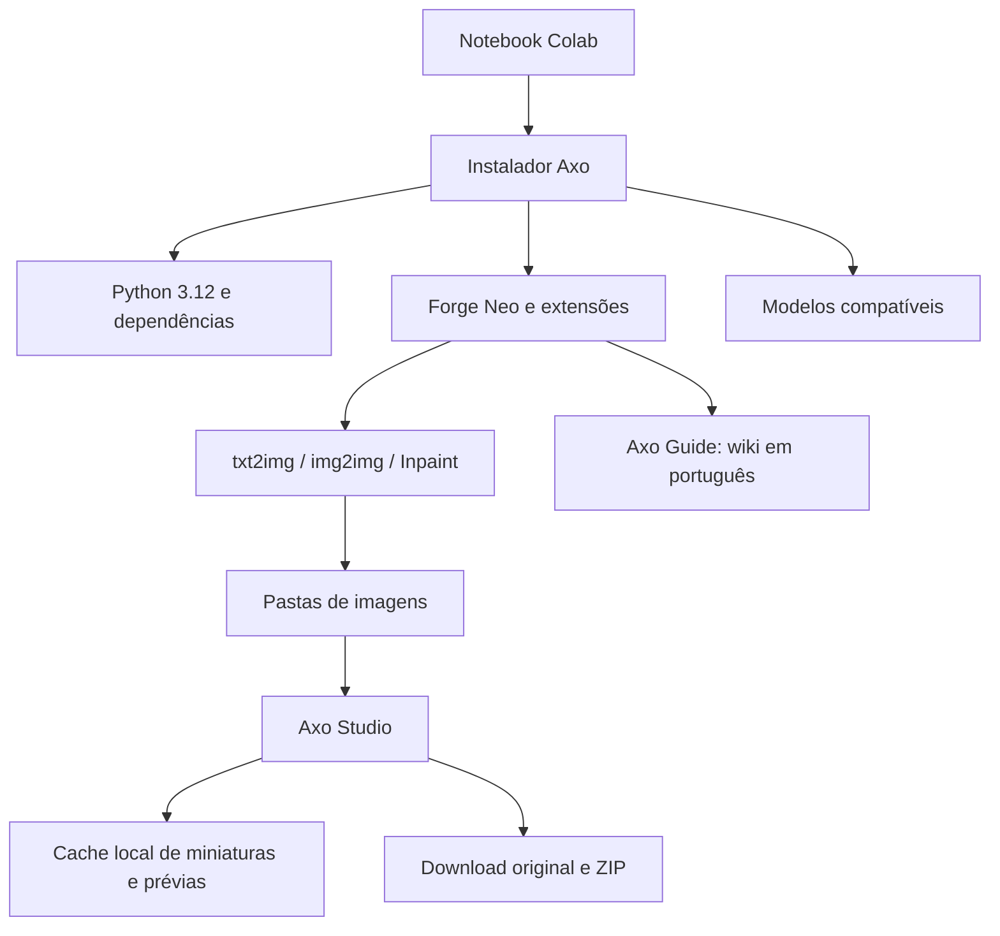

# Como o projeto funciona

O notebook prepara uma sessão do Google Colab. O Forge fornece a geração e edição de imagens; a extensão Axo adiciona a galeria, a wiki e a personalização da interface.

## Notebook independente

`tools/build_notebook.py` incorpora `axo_launcher.py` e os arquivos de `extension/` na célula de instalação. A célula escreve a extensão em `/content/axo-forge-webui/extensions/axo-image-studio` durante a preparação do Forge.

## Ambiente e armazenamento

| Caminho no Colab | Função |
|---|---|
| `/content/axo-forge-webui` | Checkout do Forge e extensões |
| `/content/axo-forge-runtime-py312` | Ambiente Python 3.12 isolado |
| `/content/axo-forge-studio` | Modelos, imagens e configuração da sessão |
| `/content/axo-forge-gallery-cache` | Cache local da galeria, separado do Drive |
| `/content/drive/MyDrive/Axo-Image-Studio-Forge` | Pasta persistente quando o Google Drive está habilitado |

O instalador fixa revisões do Forge, ADetailer e CivBrowser para manter a combinação utilizada. A localização em português é obtida separadamente. Pesos e componentes são baixados na sessão, sem fazer parte do repositório.

## Por que a galeria usa um cache próprio

A galeria entrega caminhos de arquivos ao Gradio, evitando o hook global do Forge que salva objetos PIL na pasta temporária. Miniaturas e prévias reduzidas são armazenadas no cache local. O download original copia os bytes do arquivo somente quando o usuário solicita, preservando o conteúdo original.

O visualizador considera as pastas de saída configuradas, aplica filtros e paginação e trata falhas de leitura de metadados separadamente. A atualização automática ocorre ao entrar ou retornar à aba; o botão **Atualizar** permite buscar imagens durante o uso.

## Wiki integrada

O Axo Guide mantém 29 artigos em português no arquivo `axo_guide.py`. A busca ignora diferenças de maiúsculas e acentos, pesquisa título, palavras-chave e conteúdo e prioriza correspondências no título. A navegação anterior/próxima respeita o assunto e a busca selecionados.

## Limite da validação local

Os testes carregam a interface Gradio com módulos de inferência simulados. Eles verificam as operações de biblioteca e navegação. A execução de modelos continua dependendo do Colab, da GPU, dos pesos e das extensões efetivamente instaladas.
