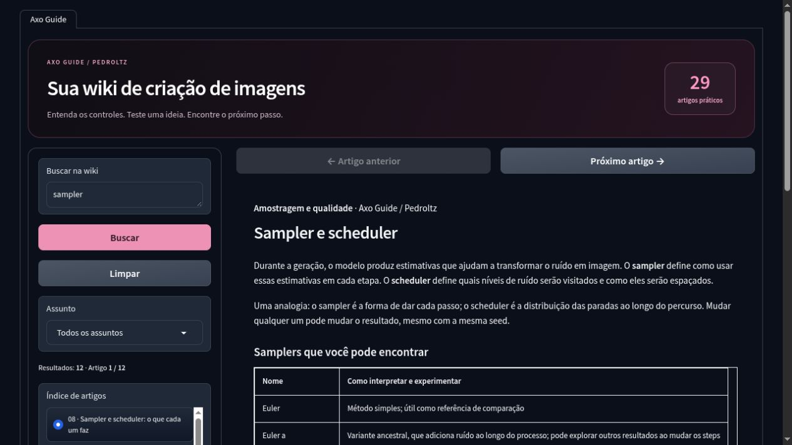
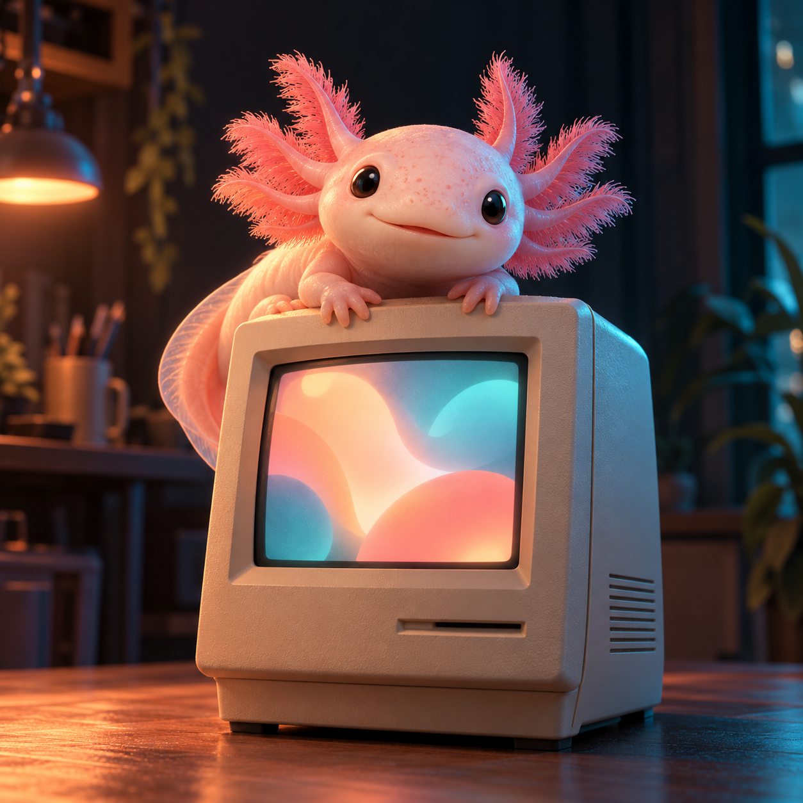
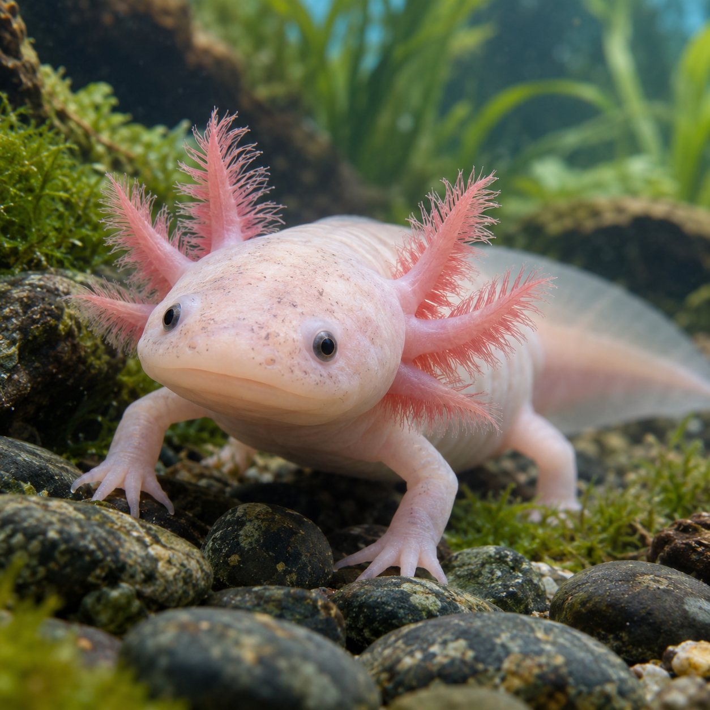

# Imagens e apresentação

Os arquivos abaixo acompanham a apresentação do Axo Image Studio. Há uma captura da interface e três artes conceituais.

## Interface do Axo Guide

Esta captura foi feita em uma prévia local da interface com módulos de inferência simulados. Ela mostra o layout, a busca e os artigos da wiki. Não mostra uma geração de imagem com GPU.

[Baixar captura original](assets/axo-guide.jpg)

## Artes conceituais

| Arte | Arquivo original | Origem |
|---|---|---|
| Mascote 3D | [PNG · 1254 × 1254](demos/01-mascote-3d.png) | Gerador de imagens externo ao Axo |
| Fantasia ilustrada | [PNG · 1254 × 1254](demos/02-fantasia-ilustrada.png) | Gerador de imagens externo ao Axo |
| Estilo fotográfico | [PNG · 1254 × 1254](demos/03-fotografia-subaquatica.png) | Gerador de imagens externo ao Axo |

Os [prompts completos](demos/PROMPTS.md) registram as especificações enviadas ao gerador. Para experimentar essas ideias no Axo, use as descrições como ponto de partida; modelo, seed e outros parâmetros podem produzir resultados diferentes.

## Mostrar uma geração do projeto

Para incluir um resultado produzido no Colab, salve a imagem original e os parâmetros reais: checkpoint, módulos, prompt, prompt negativo, sampler, scheduler, steps, CFG, seed, resolução e extensões habilitadas. Identifique essa imagem como resultado do Axo somente depois da execução real.

O [roteiro de apresentação](PRESENTATION.md) organiza os arquivos para o post. O [texto do LinkedIn](LINKEDIN_POST.md) está pronto para copiar.
